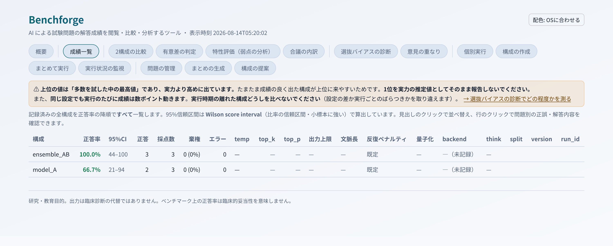
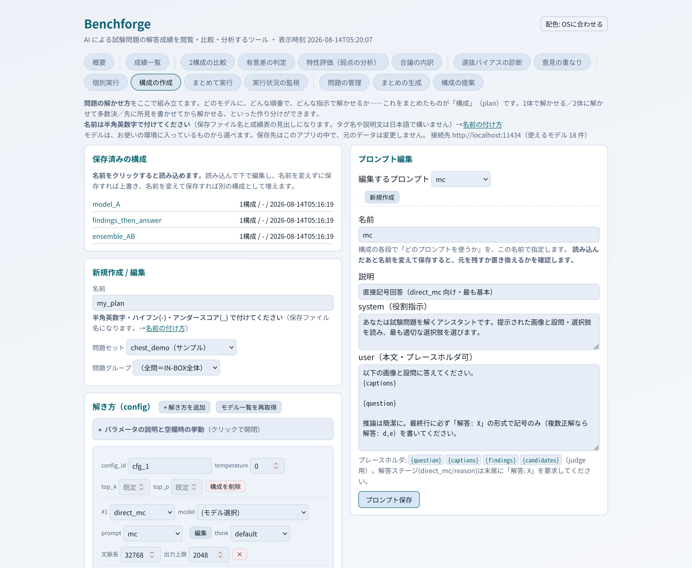
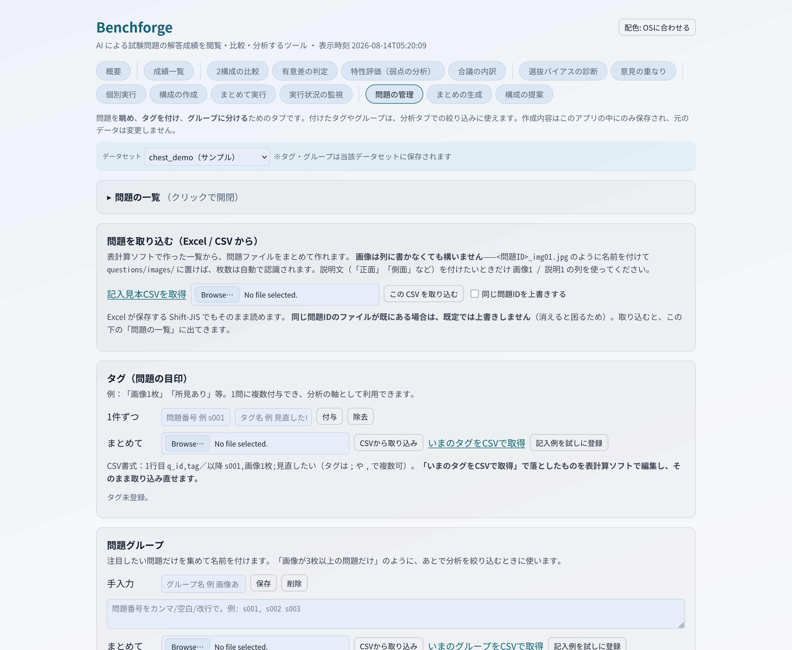

# Benchforge — 手元のPCで動く AI に試験問題を解かせ、その成績を比べるツール

**ローカル LLM に試験問題を解かせてみたいあなたへ。**

任意の試験問題を **自分のPCの中だけで動く AI（ローカル LLM）に解答させ、成績を記録・比較・分析する**
ためのブラウザツールです。画像つきの問題にも対応しています。
コマンド操作は要りません。ブラウザの画面だけで一通りできます。

- 1体の AI で解く方式と、複数の AI の解答を統合する方式を **同じ土俵で比較**できます
- どの種類の問題が得意で、どこが弱点かを **統計的に**（信頼区間・検定つきで）調べられます
- **問題も解答も、外部に送信しません。** すべて手元のPCで完結します

## 画面

**成績一覧** — 構成ごとの正答率を、95%信頼区間つきで並べます。



**構成の作成** — どのモデルに、どんな順番で、どんな指示で解かせるかを組み立てます。



**問題の管理** — 問題を眺め、タグを付け、グループに分けます。



<sub>いずれも同梱のサンプルデータで撮影したものです。</sub>

---

> **できないこと・入っていないもの**（先にお伝えします）
> - **問題データは入っていません。** 動作確認用のダミー3問のみ同梱しています。ご自分で用意してください
> - **AI 本体（モデル）も入っていません。** 別途 [ollama](https://ollama.com) で導入します（下記手順）
> - 医療機器ではありません。**出力は診断の代替になりません。** 研究・教育目的のツールです

---

## 必要環境

- **[ollama](https://ollama.com)**（AI を動かす部品。無料・Windows / macOS / Linux 対応）
- ブラウザ（Chrome / Edge / Safari / Firefox）

**Python を自分で入れる必要はありません。** セットアップ用のファイルが、必要なもの（Python 3.12 を含む）を
自動で用意します。すでに入っている Python があっても、それには触りません。

AI のモデルは**メモリの大きさ**で選びます。GPU が無くても動きますが、1問あたり数分かかります。

| 使えるメモリ | 入れるモデル | 目安 | 用途 |
|---|---|---|---|
| **6〜7 GB** | `qwen2.5vl:3b`（3.2 GB） | 内蔵GPU・古いGPU | まず動かしてみる |
| **8〜11 GB** | `qwen2.5vl:7b`（6.0 GB） | RTX 4060 など | 実用の下限 |
| **12〜23 GB** | `gemma4:12b`（7.4 GB） | RTX 4070・16GB の Mac など | 画像の読みが安定 |
| **24 GB 以上** | `gemma4:31b`（18 GB） | RTX 4090・統合メモリ機 | 本格的に使う |

- 数字は 4bit 量子化での目安です（およそ「パラメータ数 B × 0.6 GB」）
- ⚠ **モデルがメモリを超えると、動きはしますが極端に遅くなります。** 小さいものから試してください
- ⚠ **Mac（統合メモリ）は、搭載量の全部をモデルに使えるわけではありません**（おおよそ 2/3 程度）。
  実測例: 16 GB の MacBook Air で `gemma4:12b` が 8.1 GB を占有し、GPU 100% で 1問およそ40秒でした
- ⚠ 画像つきの問題を解かせるには、**画像を読めるモデル**が必要です（上の表はすべて対応）。
  テキスト専用のモデルを選ぶと、**画像が無視されて成績だけが低く出ます**

**入っているか分からない場合は、起動後に「概要」タブの環境チェックが判定して、
足りないものを実行できる形で表示します。**

---

## 入手方法

**方法1: ZIP でダウンロード**（Git を使わない方）
GitHub のページ右上「Code」→「Download ZIP」→ 展開します。

**方法2: git**

```
git clone https://github.com/m-higashi/benchforge.git
```

---

## 設置と起動

展開したフォルダは **どこに置いても動きます**（ダウンロードフォルダのままで構いません）。

アプリのデータはすべてこのフォルダの中に入りますが、**セットアップ時だけ**、
Python 環境を用意するために次の2つがホームフォルダに作られます（アンインストールは削除するだけです）。

```
~/.local/bin/uv              セットアップに使う道具
~/.local/share/uv/python/    このアプリ専用の Python 本体
```

### 1. AI を動かす部品（ollama）を入れる

[ollama.com](https://ollama.com) からインストーラを入れて実行します。入れると自動で起動します。

### 2. モデルを1つ入れる

ターミナル（Windows は PowerShell）で、上の表から選んで実行します。数 GB あるので数分かかります。

```
ollama pull qwen2.5vl:7b
```

### 3. Benchforge を起動する

| OS | 手順 |
|---|---|
| **Windows** | `Windows_setup.bat` をダブルクリック（初回のみ）→ `Windows_start.bat` をダブルクリック |
| **macOS** | `Mac_setup.command` をダブルクリック（初回のみ）→ `Mac_start.command` をダブルクリック |
| **Linux** | `bash Linux_setup.sh`（初回のみ）→ `bash Linux_start.sh` |

ブラウザで **http://127.0.0.1:8095/** を開きます。

<details><summary>うまくいかないとき</summary>

- **macOS で「Apple は…検証できませんでした」と出て起動しない** — ネット経由で入手した場合に出ます。
  出るのは `Mac_setup.command` と `Mac_start.command` の**2回**です（1回突破しても、もう一方でまた出ます）。

  実際に出る文言はお使いの macOS によって変わります。

  | 出た文言 | 突破のしかた |
  |---|---|
  | 「**Apple は、"Mac_setup.command" に…マルウェアが含まれていないことを検証できませんでした**」<br>（ボタンが「完了」しかない） | ダイアログを「完了」で閉じる →**システム設定 → プライバシーとセキュリティ** を開く → 画面を**下までスクロール** → 「"Mac_setup.command" は開発元を確認できないためブロックされました」の横の **「このまま開く」** → もう一度「このまま開く」→ Touch ID かパスワード |
  | 「**開発元を確認できません**」<br>（「開く」ボタンがある） | ファイルを**右クリック →「開く」→「開く」** |

  **新しい macOS では上の段（「完了」しかないダイアログ）になります。**
  右クリック →「開く」では突破できないので、システム設定から操作してください。
- **`python` が見つからない** — セットアップ用のファイル（`Windows_setup.bat` / `Mac_setup.command` / `Linux_setup.sh`）を先に実行してください。Python はそこで自動的に用意されます。**自分で Python を入れる必要はありません。**
- **ポート 8095 が使われている** — `config.yaml` の `port` を変更してください
- **画面が真っ白** — ブラウザの再読み込み（Ctrl+F5 / Cmd+Shift+R）をお試しください

</details>

---

## 主な機能と使い方

起動したら、**「概要」タブの環境チェック**から始めてください。準備が整っているかを判定し、
足りないものを表示します。

### はじめての流れ

1. **環境チェック**（概要タブ）— AI を動かせる状態か確認する
2. **構成の作成** — 「どの AI に、どういう手順で解かせるか」を組む。
   同梱の `model_A` を開き、**モデル欄を、手順2で入れたものに変えて保存**するのが最短です
3. **個別実行** — 同梱のサンプル問題を1問解かせてみる
4. **まとめて実行** — 問題セットをまとめて解かせる
5. **成績一覧** — 結果を見る

> **なぜ「構成の作成」が先か**: 同梱の構成は、どのモデルを使うか**空のまま**にしてあります
> （利用者ごとに入っているモデルが違うため）。空のまま実行した場合は、入っているモデルから
> 自動で1つ選んで実行し、何を使ったかを画面に表示します。**どのモデルで測るかを自分で決めたいときは、
> 先に「構成の作成」で指定してください。**

### 分析の機能

| タブ | できること |
|---|---|
| 成績一覧 | 構成ごとの正答率・信頼区間・解答時間 |
| 2構成の比較 | 同じ問題で1問ずつ突き合わせ、どちらが優れるかを検定（McNemar） |
| 有意差の判定 | 全構成を最良構成と比較してランク付け（Holm 補正つき） |
| 特性評価（弱点の分析） | 属性別の得意・不得意、全構成が誤答する難問、正解ラベルの疑わしい問題 |
| 合議の内訳 | 複数 AI で解いたとき、誰が正解し、統合で救われた／壊れたか |
| 選抜バイアスの診断 | 「たくさん試した中の最高値」がどれだけ上振れしているか |
| 意見の重なり | AI を増やしても意見が独立していない度合い（合議の限界） |

⚠ **成績を読むときの注意**（各タブにも表示されます）
- **多数の構成を試して最高値を採ると、実力より高く出ます**（選抜バイアス）
- **同じ設定でも実行ごとに結果が数ポイント動くことがあります。**
  比較したい構成は**同じ実行の中で走らせて**ください

---

## 設定

`config.yaml`（初回起動時に `config.example.yaml` から自動生成されます）を編集します。

```yaml
input:
  results_dir: データセット/chest_demo/results   # 成績データの場所
  questions_dir: ""                                # 問題の本文・画像（任意）
server:
  host: 127.0.0.1   # 自分のPCからのみ。他端末に見せるなら 0.0.0.0
  port: 8095
ollama:
  url: http://localhost:11434   # AI（ollama）の接続先。ふつうはこのまま（下記「ollama を別の場所で…」）
runner:
  backend: standalone   # このアプリだけで完結（既定）
```

- 相対パスは**このフォルダ基準**で解決されます
- 設定を壊してしまったら、`config.yaml` を削除してください。雛形から作り直されます
- `runner.backend` は `standalone`（このアプリだけで完結）のままお使いください。
  もう一方の値は、**別に用意した実行系と連携させるための開発用**で、通常は使いません

### 自分の問題を入れる

**`データセット/your_data/inbox/` に入れるだけ**です。設定ファイルをさわる必要はありません。
置いたものは、各タブの「問題セット」で `your_data（あなたのデータ）` として選べます。

```
Benchforge/
  データセット/
    chest_demo/     サンプル（動作確認用の3問）
    set2/           サンプル
    your_data/      ★ここにあなたの問題を入れます
      inbox/          answers.csv と questions/ を置く
      results/        解いた結果が自動で書かれます
```

ファイルの書き方は `データセット/README.md` をご覧ください。
**Excel で一覧を作って取り込む**こともできます（「問題の管理」タブ）。
PDF から起こす場合は、AI に変換させる手順も同じ README に載せてあります。
**`results_dir` を書き換えるのは、アプリの外にデータを置きたい場合だけ**です。

### ollama を別の場所で動かしている場合（上級者向け）

ふつうは同じ PC に入れた ollama をそのまま使うので、設定は不要です。
**Docker で動かしている・別の PC で動かしている**場合だけ、接続先を書き換えてください。

**書き換えるもの**: Benchforge のフォルダの直下にある **`config.yaml`** の、`ollama:` の下の **`url:` の行**です。

1. Benchforge を止めます（起動したときに開いたウィンドウ＝Windows はコマンドプロンプト、Mac はターミナルを閉じます）
2. `config.yaml` をテキストエディタ（Windows はメモ帳、Mac はテキストエディット）で開きます。
   見当たらない場合は、Benchforge を一度起動すると作られます
3. 次の行を探し、`http://` から後ろだけを下の表の値に書き換えて保存します。
   行の先頭の空白（半角2つ）は消さないでください

   ```yaml
   ollama:
     url: http://localhost:11434     # ← この値を書き換える（既定＝同じ PC に入れた場合）
   ```

4. Benchforge をもう一度起動します。**設定は起動したときにしか読み込まれません**

| 動かし方 | `url:` に書く値 |
|---|---|
| Docker（`-p 11434:11434` で公開した場合） | `http://localhost:11434`（既定のままで通ります） |
| Docker（ポートを変えた場合） | `http://localhost:<公開したポート>` |
| Benchforge 自体も別コンテナで動かす場合 | `http://host.docker.internal:11434`（Linux では `--add-host=host.docker.internal:host-gateway` が必要） |
| 別の PC / サーバ | `http://<その機体のアドレス>:11434` |

繋がったかどうかは「概要」タブの環境チェックで確かめられます。いまどこを見に行っているかも表示されます。

#### 別の機体の ollama に繋ぐときは、ollama 側の設定も要ります

ollama は既定では、**その機体の中からの接続しか受け付けません**。
ollama を動かしている機体のほうで、環境変数 **`OLLAMA_HOST`** を **`0.0.0.0`** にしてから ollama を起動し直します。
**信頼できるネットワーク内でのみ**行ってください（ollama には認証がありません）。

| ollama を動かしている機体 | 設定のしかた |
|---|---|
| Windows | タスクバーの ollama のアイコンから終了 → スタートメニューで「環境変数」と検索し「環境変数を編集」→ ユーザー環境変数に 名前 `OLLAMA_HOST`・値 `0.0.0.0` を新規作成 → ollama を起動し直す |
| macOS（アプリ版） | ターミナルで `launchctl setenv OLLAMA_HOST "0.0.0.0"` → メニューバーの ollama を終了して起動し直す（Mac を再起動したら、もう一度実行が必要です） |
| Linux（systemd） | `sudo systemctl edit ollama.service` で `[Service]` の下に `Environment="OLLAMA_HOST=0.0.0.0"` を書く → `sudo systemctl daemon-reload` → `sudo systemctl restart ollama` |

ファイアウォールが 11434 番ポートを止めている場合は、そこも開けてください。

---

## 他端末からのアクセス

同じ室内の別PCやタブレットから見る場合は、`config.yaml` の `host` を `0.0.0.0` にします。
ただし **認証機能はありません**。次項をお読みください。

---

## セキュリティ

**想定している使い方は「自分のPC、または信頼できるネットワークの内側」です。**

- 既定では **自分のPCからのみ**接続できます（`127.0.0.1`）
- ホスト名の検証・外部サイトからの操作の遮断・パス検証は実装済みです
- **認証（パスワード）はありません。** インターネットに直接公開しないでください。
  外から使いたい場合は VPN、または前段に認証つきの逆プロキシを置いてください

---

## バックアップと引越し

**フォルダを丸ごとコピーすれば、それがバックアップであり引越しです。**
設定・保存した構成・タグ・まとめは、すべてこのフォルダの中にあります。

- 引越し先では `setup` を1回実行してください（Python の仮想環境を作り直します）
- `.venv` フォルダはコピー不要です（作り直されます）

---

## 構成

```
run.py              起動
app/                サーバ本体（解析ロジックは app/services/）
static/             画面（JavaScript / CSS）
templates/          画面（HTML）
データセット/     問題を置く場所（サンプル2つ＋ your_data）
config.yaml         設定（初回起動時に自動生成・Git 管理外）
data/               保存した構成・タグ・まとめ（自動生成）
```

- サーバは **FastAPI**、画面は素の JavaScript（ビルド不要）
- 統計（信頼区間・McNemar 検定・Holm 補正）は**標準ライブラリのみ**で実装しています
- AI の呼び出しは ollama の HTTP API 経由です

---

## よくある質問

**Q. インターネットに接続しますか？**
A. モデルのダウンロード（`ollama pull`）以外は接続しません。問題も解答も外部に送信しません。

**Q. GPU が無くても使えますか？**
A. 使えます。ただし 1 問あたり数分かかります。まず小さいモデルでお試しください。

**Q. 同じ設定なのに結果が変わります。**
A. AI の推論は、同じ入力でも実行ごとにわずかに結果が変わることがあります（GPU の計算順序に由来）。
**比較したい構成は同じ実行の中で走らせてください。** 別々に実行した結果を比べると、
手法の差と実行ごとのばらつきが混ざります。

**Q. 画像が読まれていないようです。**
A. **画像を読めるモデル**が選ばれているか確認してください（概要タブの環境チェックで判定できます）。
テキスト専用のモデルでは画像が無視されます。

**Q. 解答が空になります。**
A. 一部のモデルは既定で「思考モード」が有効で、思考が出力の上限を使い切ることがあります。
構成の作成画面で**思考モードを切る**か、**出力上限を増やして**ください。

**Q. 医療現場で使えますか？**
A. **使えません。** 研究・教育目的のツールです。正答率は臨床的な妥当性を意味しません。

---

## ライセンス

MIT License（`LICENSE` をご覧ください）
